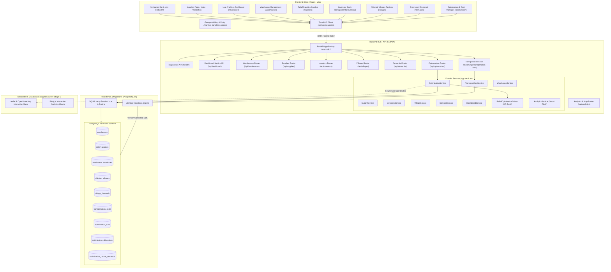
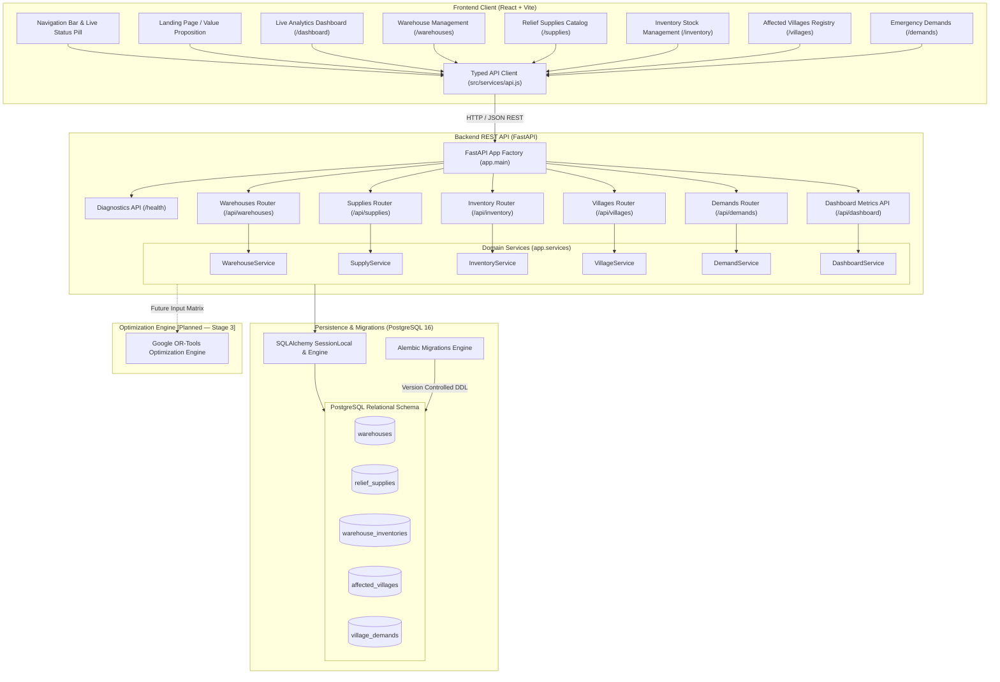

# ReliefOpt Architecture & System Design

**Project Title**: A Smart System for Planning and Optimising Emergency Relief Supply Distribution  
**Academic Project Level**: Undergraduate Mini Project  
**Current Milestone**: Stage 4 — Interactive Leaflet Maps & Plotly Analytics

---

## 1. High-Level System Architecture

ReliefOpt is structured as a decoupled client-server web application with an integrated Mixed-Integer Linear Programming (MILP) solver engine, geospatial mapping layer, Plotly analytics visualization, and relational persistence tier. The React frontend provides interactive management, optimization, mapping, and analytics workflows for disaster response operations, communicating over REST/JSON with a FastAPI backend backed by PostgreSQL, SQLAlchemy 2.0, Google OR-Tools, Leaflet, and Plotly.

---

## 2. Component Breakdown

### A. Frontend Layer (`frontend/src/`)
* **Technology**: React 18, Vite, JavaScript (ES6+), Modern Vanilla CSS, Lucide Icons.
* **Component Architecture**:
  * `App.jsx`: State coordinator, hash-based tab router (`#landing`, `#dashboard`, `#warehouses`, `#supplies`, `#inventory`, `#villages`, `#demands`, `#optimization`), toast notifications dispatcher.
  * `components/Header.jsx`: Unified navbar with navigation tabs and real-time backend/database connection status pill.
  * `pages/OptimizationPage.jsx`:
    * **Readiness Audit**: Displays available stock, total demand, warehouse/village counts, critical demands, and cost coverage status.
    * **Allocation Engine**: Trigger Google OR-Tools solver, view high-level KPIs, fairness metrics, allocations dispatch table, demand fulfilment progress, and warehouse remaining stock.
    * **Transportation Costs**: Matrix and list view of costs between warehouses and villages, add/update modal, and coordinate-based demonstration cost seeder.
    * **History & Scenarios**: Archive of historical optimization runs, plan inspection, and side-by-side scenario tradeoff comparison.

### B. Backend API Layer (`backend/app/`)
* **Technology**: Python 3.14+, FastAPI, Google OR-Tools 9.15, Uvicorn, Pydantic v2, SQLAlchemy 2.0.
* **Sub-modules**:
  * `app.services.solver_service`: Pure Google OR-Tools MIP solver encapsulating mathematical decision variables, inventory constraints, demand conservation, hierarchical urgency penalties, and fairness metrics.
  * `app.services.transport_cost_service`: CRUD operations for route costs, coverage matrix calculations, and coordinate-based demonstration cost estimation.
  * `app.services.optimization_service`: Reads current database state, executes solver, persists historical runs and allocations in PostgreSQL, and conducts What-If scenario simulations without mutating warehouse inventory.
  * `app.api.transport_costs`: REST API for managing warehouse-village transportation costs.
  * `app.api.optimization`: REST API for readiness overview, solving baseline plans, simulating scenarios, listing runs, and comparing plans.

### C. Mathematical Optimization Formulation
* **Decision Variables**:
  * $x_{w,v,s} \ge 0$: Quantity of relief supply $s$ dispatched from warehouse $w$ to village $v$.
  * $u_{v,s} \ge 0$: Unmet demand slack for supply $s$ at village $v$.
* **Constraints**:
  1. $\sum_{v} x_{w,v,s} \le I_{w,s}$ (Warehouse inventory upper bound)
  2. $\sum_{w} x_{w,v,s} + u_{v,s} = d_{v,s}$ (Village demand conservation)
  3. $x_{w,v,s} \in \mathbb{Z}_{\ge 0}, u_{v,s} \in \mathbb{Z}_{\ge 0}$ for discrete packages/kits
* **Urgency-Calibrated Objective**:
  $$\min Z = \sum_{v,s} P(\text{urgency}_{v,s}) \cdot u_{v,s} + \sum_{w,v,s} c_{w,v} \cdot x_{w,v,s}$$
  where penalties scale as $P(\text{Critical}) = 10^6 C_{\max}$, $P(\text{High}) = 10^5 C_{\max}$, $P(\text{Medium}) = 10^4 C_{\max}$, $P(\text{Low}) = 10^3 C_{\max}$. This guarantees that humanitarian life-saving priority strictly dominates transportation costs.

---

## 3. Implementation Status Matrix

| Module / Feature | Component | Status | Milestone |
| :--- | :--- | :--- | :--- |
| **Directory Scaffolding** | Full Repository | ✅ **Implemented** | Stage 1 |
| **Backend Framework** | FastAPI + Uvicorn | ✅ **Implemented** | Stage 1 |
| **Health Check API** | `GET /health` with DB status | ✅ **Implemented** | Stage 1, 2, 3 |
| **Frontend Framework** | React.js + Vite | ✅ **Implemented** | Stage 1 |
| **API Client Service** | `src/services/api.js` | ✅ **Implemented** | Stage 1, 2, 3 |
| **Connection Status UI** | Live Health & DB Indicator | ✅ **Implemented** | Stage 1, 2, 3 |
| **Emergency Landing Page**| Hero, Overview, Workflow | ✅ **Implemented** | Stage 1 |
| **PostgreSQL Database** | PostgreSQL 16 + Alembic | ✅ **Implemented** | Stage 2 & 3 |
| **Warehouse Management** | CRUD API & React Forms | ✅ **Implemented** | Stage 2 |
| **Relief Supplies Catalog**| CRUD API & React Forms | ✅ **Implemented** | Stage 2 |
| **Warehouse Inventory** | Stock Tracking & Thresholds | ✅ **Implemented** | Stage 2 |
| **Affected Villages** | CRUD API & React Forms | ✅ **Implemented** | Stage 2 |
| **Village Demands** | Urgency Tracking & Filtering | ✅ **Implemented** | Stage 2 |
| **Dashboard Summary** | Live Database Metrics API | ✅ **Implemented** | Stage 2 |
| **Transportation Costs** | CRUD API, Matrix, Seeder | ✅ **Implemented** | Stage 3 |
| **OR-Tools Solver Engine**| MIP Model & Urgency Weights | ✅ **Implemented** | Stage 3 |
| **Fairness Evaluation** | Equity Metrics & Disparity Gap | ✅ **Implemented** | Stage 3 |
| **Result Persistence** | Historical Runs & Allocations | ✅ **Implemented** | Stage 3 |
| **Scenario Simulation** | What-If Analysis (Non-mutating)| ✅ **Implemented** | Stage 3 |
| **Interactive Map** | Leaflet / OpenStreetMap | ⏳ *Pending* | Stage 4 |
| **Visual Charts** | Plotly Distribution Charts | ⏳ *Pending* | Stage 4 |

---

## 4. Key Design Decisions

1. **Strict Inventory Safety**:
   Generating an optimization plan or running what-if scenarios produces advisory recommendations. It does **not** deduct physical inventory from `warehouse_inventories` until a coordinator explicitly confirms a dispatch.
2. **Hierarchical Lexicographic Penalty Structure**:
   Unmet demand penalties ($10^6 \times C_{\max}$) strictly overpower maximum transportation costs, ensuring life-saving critical relief is never compromised for transit budget savings.
3. **Decoupled Optimization Service**:
   Mathematical modeling in `solver_service.py` is decoupled from HTTP handlers and database queries, enabling isolated unit testing and clean solver benchmarks.
4. **Permanent Run Auditing**:
   Every optimization execution is given a unique `run_id` and persisted in `optimization_runs` with complete JSON snapshot metadata, ensuring historical reproducibility across backend restarts.

---

## 1. High-Level System Architecture

ReliefOpt is structured as a decoupled client-server web application with a relational persistence tier. The React frontend provides interactive management workflows for disaster response operations, communicating over REST/JSON with a FastAPI backend backed by PostgreSQL and SQLAlchemy 2.0.

---

## 2. Component Breakdown

### A. Frontend Layer (`frontend/src/`)
* **Technology**: React 18, Vite, JavaScript (ES6+), Modern Vanilla CSS, Lucide Icons.
* **Component Architecture**:
  * `App.jsx`: State coordinator, hash-based tab router, toast notifications dispatcher, periodic backend health poller.
  * `components/Header.jsx`: Unified navbar containing brand identity, navigation tabs, and real-time backend/database connection status pill.
  * `pages/LandingPage.jsx`: Stage 1 public presentation page preserving original hero, value proposition, workflow preview, and tech stack.
  * `pages/DashboardPage.jsx`: Real-time aggregated metrics (warehouses, villages, supplies, inventory, demands, urgency distribution breakdown, empty state).
  * `pages/WarehousesPage.jsx`: Warehouse directory, coordinate and capacity display, registration modal, edit modal, stock view modal.
  * `pages/SuppliesPage.jsx`: Relief items catalog with standard category dropdown, unit metrics, safe deletion checks.
  * `pages/InventoryPage.jsx`: Stock management per warehouse, stock addition modal, inline quantity editor, low-stock threshold alerts, overall stock summary table.
  * `pages/VillagesPage.jsx`: Affected village registry with population metrics, district/state data, GPS coordinates, demand count indicators.
  * `pages/DemandsPage.jsx`: Village supply requirement tracker, urgency pill indicators (`Critical`, `High`, `Medium`, `Low`), urgency filter tabs.
  * `components/Modal.jsx`, `EmptyState.jsx`, `NotificationToast.jsx`: Reusable accessible UI primitives.
  * `services/api.js`: Centralized REST client with structured error extraction and fallbacks.

### B. Backend API Layer (`backend/app/`)
* **Technology**: Python 3.14+, FastAPI, Uvicorn, Pydantic v2, SQLAlchemy 2.0.
* **Architecture Pattern**: Layered REST architecture (`api` → `services` → `database` / `models`).
* **Sub-modules**:
  * `app.main`: Application factory, CORS middleware, router registrations under `/api`.
  * `app.core.config`: Typed settings for database URLs (`DATABASE_URL`, `TEST_DATABASE_URL`), host, port, CORS.
  * `app.database.session`: SQLAlchemy engine configured with `pool_pre_ping=True`, scoped session factory `SessionLocal`, dependency `get_db`.
  * `app.models`: Declarative SQLAlchemy models with foreign key constraints, indexes, unique constraints, and cascade rules.
  * `app.schemas`: Pydantic models enforcing strict validation (coordinate bounds, positive integers, allowed categories, urgency levels).
  * `app.services`: Encapsulated domain logic handling uniqueness enforcement, relational consistency checks, and transaction management.
  * `app.api`: Thin HTTP route handlers mapping status codes (200, 201, 204, 400, 404, 409, 422, 500).

### C. Database & Persistence Tier (`backend/alembic/`)
* **Technology**: PostgreSQL 16, `psycopg` (v3 binary driver), Alembic 1.14.
* **Schema Specifications**:
  1. `warehouses`: `id` (PK), `name` (UNIQUE), `address`, `latitude`, `longitude`, `contact_info`, `is_active`, timestamps.
  2. `relief_supplies`: `id` (PK), `name` (UNIQUE), `category`, `unit`, `description`, timestamps.
  3. `warehouse_inventories`: `id` (PK), `warehouse_id` (FK -> warehouses.id ON DELETE CASCADE), `supply_id` (FK -> relief_supplies.id ON DELETE RESTRICT), `available_quantity` (CHECK >= 0), `updated_at`, UNIQUE(warehouse_id, supply_id).
  4. `affected_villages`: `id` (PK), `name`, `district`, `state`, `latitude`, `longitude`, `population` (CHECK > 0), `is_active`, timestamps, UNIQUE(name, district).
  5. `village_demands`: `id` (PK), `village_id` (FK -> affected_villages.id ON DELETE CASCADE), `supply_id` (FK -> relief_supplies.id ON DELETE RESTRICT), `required_quantity` (CHECK > 0), `urgency_level` (CHECK in Low, Medium, High, Critical), `remarks`, timestamps, UNIQUE(village_id, supply_id).

### D. Optimization Engine (Planned — Stage 3)
* **Technology**: Google OR-Tools (Linear / Mixed-Integer Programming solver).
* **Objective**: Formulate the multi-commodity relief distribution problem:
  - Source nodes: Warehouses with verified stock.
  - Sink nodes: Affected villages with recorded demands and urgency weights.
  - Edges: Manually entered estimated transportation cost per unit.
  - Constraints: Conservation of flow, warehouse inventory upper bounds, demand fulfillment, fair allocation guarantees.

---

## 3. Implementation Status Matrix

| Module / Feature | Component | Status | Milestone |
| :--- | :--- | :--- | :--- |
| **Directory Scaffolding** | Full Repository | ✅ **Implemented** | Stage 1 |
| **Backend Framework** | FastAPI + Uvicorn | ✅ **Implemented** | Stage 1 |
| **Health Check API** | `GET /health` with DB status | ✅ **Implemented** | Stage 1 & 2 |
| **Frontend Framework** | React.js + Vite | ✅ **Implemented** | Stage 1 |
| **API Client Service** | `src/services/api.js` | ✅ **Implemented** | Stage 1 & 2 |
| **Connection Status UI** | Live Health & DB Indicator | ✅ **Implemented** | Stage 1 & 2 |
| **Emergency Landing Page**| Hero, Overview, Workflow | ✅ **Implemented** | Stage 1 |
| **PostgreSQL Database** | PostgreSQL 16 + Alembic | ✅ **Implemented** | Stage 2 |
| **Warehouse Management** | CRUD API & React Forms | ✅ **Implemented** | Stage 2 |
| **Relief Supplies Catalog**| CRUD API & React Forms | ✅ **Implemented** | Stage 2 |
| **Warehouse Inventory** | Stock Tracking & Thresholds | ✅ **Implemented** | Stage 2 |
| **Affected Villages** | CRUD API & React Forms | ✅ **Implemented** | Stage 2 |
| **Village Demands** | Urgency Tracking & Filtering | ✅ **Implemented** | Stage 2 |
| **Dashboard Summary** | Live Database Metrics API | ✅ **Implemented** | Stage 2 |
| **OR-Tools Solver** | Supply Allocation Engine | ✅ **Implemented** | Stage 3 |
| **Transportation Costs** | Matrix & Haversine Seeder | ✅ **Implemented** | Stage 3 |
| **Plan Persistence** | Runs, Allocations & Scenarios | ✅ **Implemented** | Stage 3 |
| **Interactive Map** | Leaflet / OpenStreetMap | ✅ **Implemented** | Stage 4 |
| **Visual Charts** | Plotly Distribution Charts | ✅ **Implemented** | Stage 4 |
| **Geospatial Routes**| Allocation Links on Map | ✅ **Implemented** | Stage 4 |
| **Analytics Filters**| Multi-Dimension Filter Bar | ✅ **Implemented** | Stage 4 |

---

## 4. Key Design Decisions

1. **Direct PostgreSQL 16 + SQLAlchemy 2.0**:
   Instead of in-memory dictionaries or SQLite, we use industry-standard PostgreSQL 16 with SQLAlchemy 2.0 declarative models and Alembic migrations, guaranteeing ACID compliance, multi-user concurrency, and data persistence across server restarts.
2. **PostgreSQL Check Constraints & Foreign Keys**:
   Business rules (non-negative inventory, positive population, valid urgency levels) are enforced at both the database engine level (PostgreSQL `CheckConstraint`) and the API layer (Pydantic `@field_validator`), preventing invalid data from ever corrupting storage.
3. **Dedicated Test Database**:
   Testing uses an isolated database (`reliefopt_test_db`) so automated pytest runs never tamper with coordinator development data in `reliefopt_db`.
4. **Denormalized Response Payloads**:
   Inventory and Demand endpoints perform joined queries to return human-readable warehouse and supply names directly in the response payload, minimizing round-trip HTTP overhead from the frontend client.
5. **Stage 1 Preservation**:
   All Stage 2 management pages are seamlessly integrated via navigation tabs while preserving the complete Stage 1 landing page, color scheme, design tokens, and diagnostic health card.
